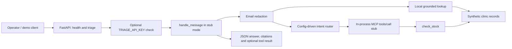

# Architecture

## Diagram

The health endpoint returns directly without message handling or authentication.
The stock tool is invoked only for logistics intents. This is a deterministic teaching
pipeline; there is no live LLM or network MCP server.

## Module boundaries

- `services/triage/app.py`: FastAPI endpoints, input validation, optional API-key dependency, and service orchestration.
- `services/triage/redact.py`: replaces email addresses before routing and retrieval.
- `services/triage/rag.py`: keyword retrieval over clinic records and deterministic answers with source citations.
- `services/triage/rag_smoke.py`: checks retrieval, source provenance, grounded output, and unmatched queries.
- `agents/router.py`: routes using tools and keywords from `config.json`.
- `agents/tools/mcp_stub.py`: local MCP-shaped stock-tool dispatch; `logistics.py` reads synthetic stock.
- `services/triage/prompts/pin.json`: records `stub-local`, prompt version `1.2.0`, prompt filename and hash. The stub does not execute the prompt.
- `tests/`, `evals/`, and `scripts/`: unit/security checks, live health integration, fixture diagnosis, evaluation, and performance measurement.
- `docs/`: operator runbooks and build evidence.

## Data boundaries

`fixtures/triage_messages_sample.jsonl` contains 300 synthetic routing records;
`fixtures/clinics.json` contains synthetic clinic stock used for retrieval and tools.
`evals/golden.jsonl` holds the separate three-case evaluation set.
The routing sample includes catalog-intent examples for testing only; these are not
patient records. No production patient data or marketplace scrape is ingested.

The pipeline returns redacted message text and does not persist incoming messages.
Redaction covers email addresses only. Retrieved stock facts are demo data, not clinical advice.
Catalog intents are routed but image analysis is deferred.
